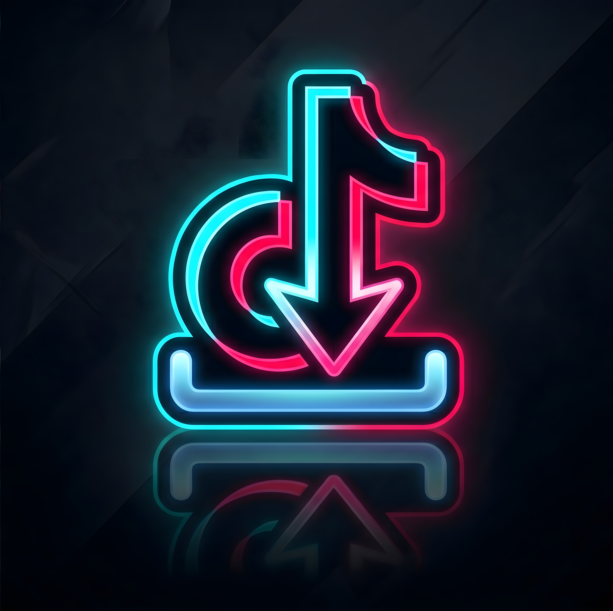

<p align="center">
  
</p>

<p align="center">
  
  
  
  
  
  
</p>

<h1 align="center">
  📱 TikTok Downloader — Suite Móvil & Backend Privado Cobalt
</h1>

<p align="center">
  <strong>Aplicación multiplataforma de descarga multimedia en alta resolución sin marcas de agua, potenciada por una instancia contenerizada de la API de Cobalt v11.</strong>
</p>

<p align="center">
  A diferencia de alternativas públicas plagadas de publicidad invasiva o servicios con rate-limits abusivos, este proyecto implementa una arquitectura desacoplada: un cliente nativo en Flutter conectado a un microservicio backend autoalojado de alto rendimiento.
</p>

---

## 📑 Tabla de Contenidos
- [🎯 Propuesta Técnica](#-propuesta-técnica)
- [✨ Características Principales](#-características-principales)
- [🏗️ Arquitectura del Sistema](#️-arquitectura-del-sistema)
- [🛠️ Stack Tecnológico](#️-stack-tecnológico)
- [🚀 Despliegue y Ejecución](#-despliegue-y-ejecución)
  - [1. Levantar el Backend (Cobalt API)](#1-levantar-el-backend-cobalt-api)
  - [2. Ejecutar la App Móvil (Flutter)](#2-ejecutar-la-app-móvil-flutter)
- [📁 Estructura del Código](#-estructura-del-código)
- [🧪 Pruebas Automatizadas](#-pruebas-automatizadas)
- [📄 Licencia](#-licencia)

---

## 🎯 Propuesta Técnica

La descarga de contenido de TikTok suele ser inestable debido a constantes cambios en las cabeceras HTTP y mecanismos anti-scraping de la plataforma.

Este proyecto resuelve el problema mediante:
1. **Instancia Privada de Cobalt:** Se ejecuta un contenedor ligero de [Cobalt](https://github.com/imputnet/cobalt) (v11) que se encarga del túnel y desencriptado de URLs en tiempo real.
2. **Cliente Nativo Flutter:** Una experiencia de usuario limpia, con detección inteligente de enlaces del portapapeles, barra de progreso en vivo, guardado directo en la galería del dispositivo y reproductor de video integrado para previsualización inmediata.

---

## ✨ Características Principales

- 🎬 **Descargas sin Marca de Agua:** Extracción directa del flujo de video original en calidad Full HD (1080p).
- 📋 **Detección Automática de Portapapeles:** Al abrir la aplicación, reconoce URLs válidas de TikTok (`vm.tiktok.com`, `tiktok.com/@...`) listas para descargar.
- 📺 **Reproductor Integrado:** Vista previa nativa de videos descargados dentro de la aplicación con controles de pausa, avance y repetición.
- 💾 **Persistencia & Galería:** Guardado automático en el almacenamiento multimedia del dispositivo (`Movies/TikTokDownloader`) con solicitud reactiva de permisos (Android 13+ Granular Permissions & Legacy Storage).
- 📤 **Compartir Directo:** Exportación hacia redes sociales y mensajería instantánea mediante integración nativa con el sistema operativo (`share_plus`).
- ⚡ **Procesamiento con FFmpeg:** Soporte integrado con `ffmpeg_kit_flutter` para transcodificación y remuxing de audio/video.

---

## 🏗️ Arquitectura del Sistema

```mermaid
graph TD
    subgraph Mobile ["Cliente Móvil / Desktop (Flutter)"]
        UI[DownloadScreen & SplashScreen]
        CLIP[Clipboard Listener]
        CTRL[TikTokService & CobaltService]
        PLAY[VideoPlayerScreen]
        STORE[Gallery & Local Storage]
    end

    subgraph Backend ["Backend Contenerizado (Docker / Podman)"]
        CONTAINER[Cobalt v11 API Container :9000]
    end

    subgraph External ["Red Externa"]
        TIKTOK[(Servidores TikTok CDN)]
    end

    UI --> CLIP
    UI --> CTRL
    CTRL -->|POST / (URL payload)| CONTAINER
    CONTAINER -->|Handshake & Extracción| TIKTOK
    CONTAINER -->|Stream / Direct Media URL| CTRL
    CTRL -->|Guardar archivo| STORE
    CTRL -->|Previsualizar| PLAY
```

---

## 🛠️ Stack Tecnológico

| Componente | Tecnología | Rol |
|---|---|---|
| **Frontend Framework** | [Flutter 3.x](https://flutter.dev/) | Desarrollo multiplataforma con UI reactiva en Dart |
| **Cliente HTTP** | [Dio ^5.7](https://pub.dev/packages/dio) | Conexión HTTP avanzada con timeouts, interceptores y streams |
| **Backend de Extracción** | [Cobalt v11](https://github.com/imputnet/cobalt) | Motor API open-source para extracción limpia de contenido |
| **Contenedores** | [Docker / Podman](https://podman.io/) | Despliegue aislado del microservicio API |
| **Multimedia** | [video_player](https://pub.dev/packages/video_player) & [ffmpeg_kit](https://pub.dev/packages/ffmpeg_kit_flutter_new) | Decodificación y transcodificación de audio/video |
| **Almacenamiento** | [image_gallery_saver_plus](https://pub.dev/packages/image_gallery_saver_plus) | Indexación directa en el álbum multimedia de Android e iOS |

---

## 🚀 Despliegue y Ejecución

### 1. Levantar el Backend (Cobalt API)

En la raíz del proyecto se incluye la configuración de orquestación en `backend/cobalt/compose.yml`:

```bash
# Con Docker Compose
docker compose -f backend/cobalt/compose.yml up -d

# O con Podman
podman-compose -f backend/cobalt/compose.yml up -d
```
Verifica que el servicio responda accediendo a `http://127.0.0.1:9000`.

---

### 2. Ejecutar la App Móvil (Flutter)

1. **Configurar el reenvío de puertos para depuración Android por cable:**
   ```bash
   adb reverse tcp:9000 tcp:9000
   ```

2. **Instalar paquetes de Flutter:**
   ```bash
   flutter pub get
   ```

3. **Iniciar la aplicación:**
   ```bash
   # Apuntando al endpoint de Cobalt configurado
   flutter run --dart-define=COBALT_API_URL=http://127.0.0.1:9000
   ```

4. **Compilar APK de Producción:**
   ```bash
   flutter build apk --release --dart-define=COBALT_API_URL=https://tu-dominio-cobalt.com
   ```

---

## 📁 Estructura del Código

```plaintext
TiktokDownload/
├── backend/
│   └── cobalt/
│       ├── compose.yml              # Orquestación del contenedor API Cobalt v11
│       └── README.md                # Guía de despliegue con Podman/Docker
├── lib/
│   ├── main.dart                    # Punto de entrada y tema oscuro Material 3
│   ├── screens/
│   │   ├── download_screen.dart     # Pantalla principal con input y animación
│   │   ├── splash_screen.dart       # Presentación de marca
│   │   └── video_player_screen.dart # Reproductor nativo de videos descargados
│   └── services/
│       ├── cobalt_service.dart      # Conexión con la API de Cobalt (POST requests)
│       ├── history_service.dart     # Historial de descargas realizadas
│       └── tiktok_service.dart      # Validación de URLs y parsing de streams
├── test/
│   ├── tiktok_service_test.dart     # Pruebas unitarias de parsing y servicios
│   └── widget_test.dart             # Pruebas de widgets
├── pubspec.yaml                     # Manifiesto y dependencias de Flutter
└── analysis_options.yaml            # Reglas de linting de código Dart
```

---

## 🧪 Pruebas Automatizadas

El proyecto incluye tests unitarios para verificar la integridad de las rutas y el tratamiento de errores:

```bash
flutter test
```

---

## 📄 Licencia

Este proyecto está bajo la Licencia [MIT](LICENSE).
